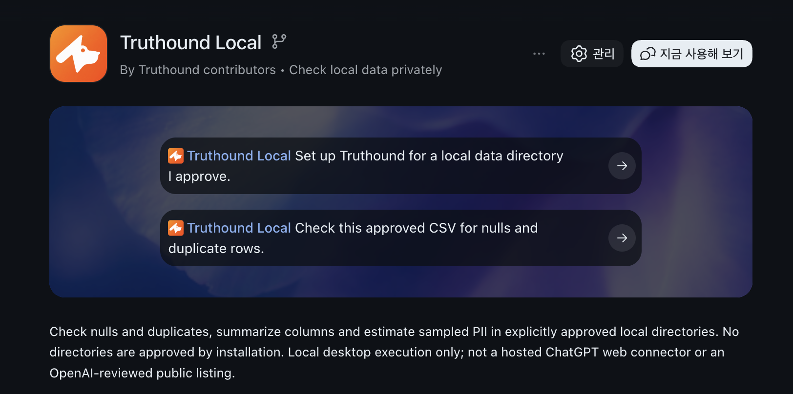

<div align="center">
  
</div>

<h1 align="center">Truthound — Data Quality Workflow</h1>

<!-- mcp-name: io.github.seadonggyun4/truthound -->

<p align="center">
  <strong>Polars 기반 제로 설정 데이터 품질 프레임워크</strong> <br/>
  <strong>Zero-Configuration Data Quality Framework Powered by Polars</strong>
</p>

<p align="center">
  <em>Sniffs out bad data.</em>
</p>

[](https://truthound.netlify.app/)
[](https://pypi.org/project/truthound/)
[](https://www.python.org/downloads/)
[](https://opensource.org/licenses/Apache-2.0)
[](https://pola.rs/)
[](https://github.com/ddotta/awesome-polars)

[](https://pepy.tech/project/truthound)
[](https://pepy.tech/project/truthound)
[](https://pepy.tech/project/truthound)

<!--
README HEADER FORMAT LOCK:
The exact header format above MUST be preserved.
Do not rewrite it as Markdown-only syntax, do not remove the centered HTML,
do not change the banner image block, title, bilingual subtitle, slogan, or
badge block, and do not reorder those elements.
This required format starts at:
  <div align="center">
and ends at the closing </p> of the badge block above.
-->

---

## Plugin Platform

### Use through MCP

Connect Truthound Local to Codex or Claude Desktop to check approved local data for nulls and duplicates, summarize columns, and run sampled PII detection.



- **[Install in Codex](docs/guides/mcp.md#openai-local-plugin-and-repository-marketplace)** — prerequisites, repository marketplace setup, plugin installation, and directory approval
- **[Install in Claude Desktop](docs/guides/mcp.md#claude-desktop-bundle)** — MCPB download, extension installation, and directory configuration

After installation, approve the data directories you want to use. For other MCP clients, see the [Registry and client connection guide](docs/guides/mcp.md#registry-metadata-and-installation).

Use the Core profile for drift comparison, masking and schema validation alongside basic validation, profiling and PII detection. See [the core workflow and profile selection](docs/guides/mcp.md#core-data-quality-workflow).

---

## Overview

Truthound is an open-source framework for data validation and data quality workflows. Built around a Polars-first validation kernel, it lets teams declare schema checks, custom rules, quality checks, and anomaly detection in code, then manage the results reproducibly.

Truthound is an open-source framework for data validation and data quality
workflows, built on a Polars-first validation kernel.

`th.scan()` inspects the first 1,000 non-null values per string column and estimates finding counts. Local Parquet inputs use 1,024-row batches when PyArrow is installed; complete Parquet footer counts avoid reading already-sampled columns further, while missing statistics retain full batched counting. Other inputs use lazy scalar counts and bounded samples. This is not a full-row inspection guarantee. See the [PII API](docs/python-api/core-functions.md#thscan).

The benchmark CLI supports `--size stress` (100 million rows); `--rows` overrides the preset. See the [benchmark command](docs/cli/benchmark/run.md). Console and JSON benchmark output work without the optional HTML reporting dependencies.

**Documentation**: [truthound.netlify.app](https://truthound.netlify.app/)

---

## Introduction

Truthound provides an open-source data validation framework and workflow orchestration layer built on Polars. It supports schema validation, custom rules, quality checks, anomaly detection, and related validation capabilities. It can also be connected to major workflow environments such as Airflow, Dagster, and Prefect to automate validation steps. With a code-first declarative validation style, Truthound improves reproducibility and maintainability for data quality management and is designed to fit naturally into many data pipelines.

Truthound is an open-source ecosystem composed of two repositories.

| Component | Repository | Role |
| --- | --- | --- |
| **Truthound** | [`truthound`](https://github.com/seadonggyun4/truthound) | Validation kernel — `th.check()`, `ValidationRunResult`, planner/runtime, zero-configuration workspace, reporters, checkpoints |
| **Truthound Orchestration** | [`truthound-orchestration`](https://github.com/seadonggyun4/truthound-orchestration) | Workflow integration layer for Airflow, Dagster, Prefect, dbt, Mage, Kestra, and similar environments |

---

## Key Features

<!--
FACT-CHECK LOCK, 2026-07-01:
The default th.check() local runtime is Polars/LazyFrame based, but it executes
validators sequentially through ValidationRuntime._execute_sequential().
ExpressionBatchExecutor and SharedMetricStore provide batched/deduplicated
metric execution utilities, but ScanPlanner does not automatically fuse all
validator metrics into one collect() on the default path.
-->
- **Polars-first execution**: Local validation uses Polars `LazyFrame` as the reference path. Batched expression and shared-metric utilities are available, but the default `th.check()` path does not automatically fuse every validator metric into one aggregate query.
- **Zero-Configuration**: `th.check(data)` automatically creates and reuses a local `.truthound/` workspace.
- **Deterministic auto validation suites**: Selects only relevant checks using schema, nullability, type, range, and key heuristics instead of "run everything."
- **Single result model**: Checkpoints, reporters, validation docs, and plugins all share one `ValidationRunResult`.
- **Explicit contracts**: Provides stable interfaces for contexts, check factories, backends, and artifact generation.
- **Workflow integration**: Truthound Orchestration enables host-native execution inside schedulers and workflow systems.

> AI review features are optional helper layers. Truthound's core is a data quality workflow; AI only assists with human-reviewable prompt-based validation suggestions and run analysis. All core features work without AI.

---

## Benchmark

The table below preserves historical measurements from the previously published fixed-runner release artifact set. Under the conditions recorded for those eight comparable workloads, Truthound measured faster execution time and lower memory usage than Great Expectations while preserving correctness. These results do not establish a performance pass for later versions or a changed methodology.

| Workload | Truthound Warm (s) | GX Warm (s) | Speedup | Memory Ratio |
| --- | --- | --- | --- | --- |
| local-mixed-core-suite | 0.028240 | 0.075232 | 2.66x | 44.29% |
| local-null | 0.016487 | 0.024964 | 1.51x | 43.62% |
| local-range | 0.002470 | 0.013219 | 5.35x | 43.84% |
| local-schema | 0.001479 | 0.017303 | 11.70x | 35.88% |
| local-unique | 0.002023 | 0.013785 | 6.81x | 42.28% |
| sqlite-null | 0.007370 | 0.032909 | 4.47x | 48.16% |
| sqlite-range | 0.006053 | 0.022355 | 3.69x | 43.80% |
| sqlite-unique | 0.002066 | 0.015655 | 7.58x | 42.12% |

This comparison is limited to deterministic core checks and SQLite pushdown workloads. It is not a generalized claim about every feature area. The repository-local `.truthound/benchmarks/artifacts` directory may contain only a subset of raw observations; treat the release artifact set and the [Latest Verified Benchmark Summary](https://github.com/seadonggyun4/truthound/blob/main/docs/releases/latest-benchmark-summary.md) as the official source for these numbers.

New benchmarks default to `truthound-parity-thread-budget-v2`: an equal worker thread budget of `1` for both frameworks, one cold iteration, and seven warm iterations, retaining correctness for every iteration and every warm sample. Historical results are not overwritten; direct comparison requires matching methodology, workload contract, dataset, backend, and exactness. When a corrected harness verifies a published wheel, its revision is recorded separately from the wheel version and digest. Authoritative release verification requires the complete default methodology and unchanged thresholds; custom methodologies are advisory. A new performance pass requires actual verified artifacts. See [Benchmark Methodology](docs/guides/benchmark-methodology.md).

Primary reasons for the performance difference:
- Polars `LazyFrame` based local execution and SQL pushdown paths
- batched expression and shared-metric optimization utilities used by some validators and advanced execution paths
- deterministic auto-suite selection that keeps default work exact and relevant
- a lightweight zero-configuration context that preserves baselines and artifacts without heavy project bootstrapping
- a single result contract shared by reporters, checkpoints, and validation docs

---

## Quick Start

### Installation

```bash
pip install truthound
```

```bash
# Optional AI review features
pip install truthound[ai]
```

```bash
# Development/docs workflow in this repository
uv sync --extra dev --extra docs
```

### Python API

```python
import truthound as th
from truthound.datadocs import generate_validation_report
from truthound.reporters import get_reporter
from truthound.drift import compare

run = th.check(
    {"customer_id": [1, 2, 2], "email": ["a@example.com", None, "c@example.com"]},
)

print(run.execution_mode)
print([check.name for check in run.checks])
print(run.metadata["context_root"])

json_report = get_reporter("json").render(run)
validation_docs = generate_validation_report(run, title="Customer Quality Overview")

context = th.get_context()
schema = th.learn({"id": [1, 2], "status": ["active", "inactive"]})
masked = th.mask(
    {"email": ["a@example.com", "b@example.com"]},
    columns=["email"],
    strategy="hash",
)
drift = compare({"score": [0.1, 0.2]}, {"score": [0.1, 0.8]})
```

- **Reports**: A4 HTML/PDF; public themes are `light`, `dark`, and `minimal`. Reports include numbered tables, figures and appendices, quality dimensions, diagnostic criteria and thresholds.
- **PDF layout**: Long tables and sections span pages; cards that fit on one page stay together. Long column names and JSON examples wrap without truncation.
- **Types and statistics**: Types use `inferred_type` → `physical_type` → `dtype`, falling back to `unknown`. Undefined skewness and kurtosis use JSON `null`; source values and other statistics remain unchanged.
- **Advanced integration**: Inspect structure with `ReportDocument`; compatibility with `generate_html_report`, `HTMLReportBuilder`, and `export_to_pdf` is preserved.

### CLI

```bash
truthound check data.csv --validators null,unique
truthound check --connection "sqlite:///warehouse.db" --table users --pushdown
truthound scan pii.csv
truthound profile data.csv
truthound doctor . --workspace
truthound plugins list --json
```

```bash
# Optional AI review workflow
truthound ai suggest-suite data.csv --prompt "Require customer_id to be unique"
truthound ai proposals list
truthound ai explain-run --run-id <run_id>
```

---

## Zero-Config Workflow

Truthound automatically creates a `.truthound/` workspace at the project root. By default it manages:

- `.truthound/config.yaml`: resolved project defaults
- `.truthound/catalog/`: asset fingerprints and source signatures
- `.truthound/baselines/`: learned schemas and metric history
- `.truthound/runs/`: persisted `ValidationRunResult` metadata
- `.truthound/docs/`: generated validation docs
- `.truthound/plugins/`: resolved plugin manifest and trust metadata

If you do nothing except call `th.check(data)`, Truthound will:

1. detect the asset/backend
2. resolve the active `TruthoundContext`
3. load or create a baseline
4. synthesize an auto validation suite
5. plan and execute validation
6. persist the run and validation docs when enabled

Use `truthound doctor . --workspace` to check the structural integrity of the local `.truthound/` layout, indexes, baselines, and persisted run artifacts.

---

## Public Surface

Public functions and types load on first access and retain the existing native Core objects and behavior.

Lineage sample metadata now requires explicit opt-in and is copied with row/byte bounds; source assets are never sampled automatically.

Advanced Arrow conversion now applies captured index/null/temporal policies and row/byte bounds across generic and distributed conversions; see the distributed profiling guide for materialization limits.

Filesystem suite queries honor selected ordering before pagination; ambiguous JSON records cannot be adopted by index rebuild.

The root package intentionally exposes a small API.

- Stable facade: `check`, `scan`, `mask`, `profile`, `learn`, `read`, `get_context`
- Core types: `TruthoundContext`, `ValidationSuite`, `CheckSpec`, `SchemaSpec`, `ValidationRunResult`, `CheckResult`
- `th.check()` returns `ValidationRunResult` directly.
- Checkpoint results: `CheckpointResult.validation_run` is canonical, while `CheckpointResult.validation_view` is a legacy compatibility projection.
- Reporter types: `truthound.reporters.RunPresentation`, `truthound.reporters.ReporterContext`
- Validation docs entry points: `truthound.datadocs.ValidationDocsBuilder`, `truthound.datadocs.generate_validation_report`
- Drift comparison: `truthound.drift.compare`; explicit zero thresholds are preserved, and invalid settings or nonfinite numeric inputs fail visibly.
- ERD audit (in development): [`truthound.schema_audit`](docs/python-api/schema-audit.md) provides immutable models, JSON, digests, standards-to-design audit A, design-to-catalog audit B and bounded PG14/17 read-only collection. Console, connection authorization and approval authority remain separate.
- Advanced systems: import by namespace, for example `truthound.ml`, `truthound.lineage`, `truthound.realtime`, `truthound.datadocs`. Native model constructors copy configuration and reject unknown overrides. Training samples use seeded priorities, and built-in detectors preserve trained state when refitting fails. Concept drift provides a correlation default and native River DDM, ADWIN, and Page-Hinkley stream comparisons ([contract](docs/cli/ml/drift.md)). Lineage tracking supports explicit row positions, context edges, durable tracker snapshots, and explicit bounded samples; OpenLineage delivery retains uncertain transitions and joins owned requests on shutdown ([contract](docs/guides/advanced/lineage.md)).
- Optional AI layer: install `truthound[ai]`, then import `truthound.ai`

---

## Documentation

- Main docs portal: [truthound.netlify.app](https://truthound.netlify.app/)
- Overview: [docs/index.md](https://github.com/seadonggyun4/truthound/blob/main/docs/index.md)
- Getting started: [docs/getting-started/index.md](https://github.com/seadonggyun4/truthound/blob/main/docs/getting-started/index.md)
- Architecture: [docs/concepts/architecture.md](https://github.com/seadonggyun4/truthound/blob/main/docs/concepts/architecture.md)
- Zero-config context: [docs/concepts/zero-config.md](https://github.com/seadonggyun4/truthound/blob/main/docs/concepts/zero-config.md)
- Guides: [docs/guides/index.md](https://github.com/seadonggyun4/truthound/blob/main/docs/guides/index.md)
- Reference: [docs/reference/index.md](https://github.com/seadonggyun4/truthound/blob/main/docs/reference/index.md)
- AI docs: [docs/ai/index.md](https://github.com/seadonggyun4/truthound/blob/main/docs/ai/index.md)
- Orchestration: [truthound.netlify.app/orchestration/](https://truthound.netlify.app/orchestration/)
- Orchestration getting started: [docs/orchestration/getting-started.md](https://github.com/seadonggyun4/truthound/blob/main/docs/orchestration/getting-started.md)
- Latest verified benchmark summary: [docs/releases/latest-benchmark-summary.md](https://github.com/seadonggyun4/truthound/blob/main/docs/releases/latest-benchmark-summary.md)

---

Expression validation keeps failure samples, counts and rows attached to the reported column after passing checks are omitted.

The `ai`, `mcp` and `all` extras share a Pydantic 2.11 minimum in 3.3.0.
Build a Core MCPB with `truthound-mcp bundle --profile core --output truthound-core.mcpb`. The separate `truthound-core` plugin candidate pins Core 3.3.0 and uses explicit data, workspace, control and disclosure grants; reconnect after changes.

## License

Apache License 2.0. See [LICENSE](https://github.com/seadonggyun4/truthound/blob/main/LICENSE) for details.
