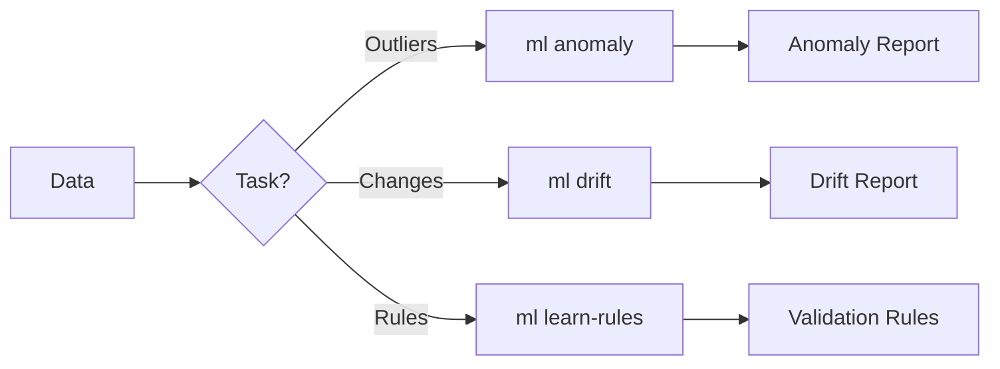

# ML 명령

CLI 명령 실행에서 Machine을(를) 기준으로 데이터 품질 검증, 워크플로우 자동화, 결과 해석 방법을 설명합니다.

## 네이티브 모델 설정과 실패 처리

Python `truthound.ml` 모델 생성자는 전달된 설정과 변경 가능한 override를
독립 복사합니다. 키워드 override는 호출자의 설정을 바꾸지 않고 알 수 없는 설정
이름은 무시하지 않고 `ValueError`로 보고합니다. 모델 자체의 `config`는 명시적으로
변경할 수 있는 설정 표면으로 유지됩니다. Concept drift 학습은 누락된 지정 feature를
거부하고 상관관계 계산 실패를 `ModelTrainingError`로 보고합니다. 탐지에서도 target
또는 학습된 지정 feature의 누락을 거부하며 0 상관관계나 정상적인 드리프트 없음으로
바꾸지 않습니다. 선택된 MCP 모델 생성·탐지 연산에도 같은 계약이 적용됩니다.


모델 복구는 앙상블 하위 모델까지 포함한 네이티브 학습 상태의 별도 복사본에 먼저
적용한 뒤 사용 중인 객체에 반영합니다. 잘못된 파일은 기존 학습 모델과 설정을
보존합니다. 사용자 정의 모델 상태는 단계적 복구를 위해 복사를 지원해야 합니다.
저장은 임시 형제 파일의 원자적 게시를 사용하며 교체 전 실패는 기존 파일을 보존합니다.
교체 후 디렉터리 동기화 실패는 실제 게시 파일을 확인해야 합니다. 모델 객체별로
작성자는 하나만 사용합니다.


## 개요

| CLI 명령 실행에서 Command을(를) 기준으로 데이터 품질 검증, 워크플로우 자동화, 결과 해석 방법을 설명합니다. | CLI 명령 실행에서 Description을(를) 기준으로 데이터 품질 검증, 워크플로우 자동화, 결과 해석 방법을 설명합니다. | CLI 명령 실행에서 Primary, Case을(를) 기준으로 데이터 품질 검증, 워크플로우 자동화, 결과 해석 방법을 설명합니다. |
|---------|-------------|------------------|
| CLI 명령 실행에서 `anomaly`을(를) 기준으로 데이터 품질 검증, 워크플로우 자동화, 결과 해석 방법을 설명합니다. | CLI 명령 실행에서 Detect을(를) 기준으로 데이터 품질 검증, 워크플로우 자동화, 결과 해석 방법을 설명합니다. | CLI 명령 실행에서 Outlier을(를) 기준으로 데이터 품질 검증, 워크플로우 자동화, 결과 해석 방법을 설명합니다. |
| CLI 명령 실행에서 `drift`을(를) 기준으로 데이터 품질 검증, 워크플로우 자동화, 결과 해석 방법을 설명합니다. | Detect data 드리프트 | Model 모니터링 |
| CLI 명령 실행에서 `learn-rules`을(를) 기준으로 데이터 품질 검증, 워크플로우 자동화, 결과 해석 방법을 설명합니다. | CLI 명령 실행에서 관련 설정과 실행 흐름을(를) 기준으로 데이터 품질 검증, 워크플로우 자동화, 결과 해석 방법을 설명합니다. | CLI 명령 실행에서 Rule을(를) 기준으로 데이터 품질 검증, 워크플로우 자동화, 결과 해석 방법을 설명합니다. |

## What is ML-based Detection?

CLI 명령 실행에서 ML-based을(를) 다루는 항목입니다:

- CLI 명령 실행에서 Detect, Find을(를) 기준으로 데이터 품질 검증, 워크플로우 자동화, 결과 해석 방법을 설명합니다.
- CLI 명령 실행에서 Detect, Identify을(를) 기준으로 데이터 품질 검증, 워크플로우 자동화, 결과 해석 방법을 설명합니다.
- CLI 명령 실행에서 Automatically을(를) 기준으로 데이터 품질 검증, 워크플로우 자동화, 결과 해석 방법을 설명합니다.

## 워크플로우



## Quick 예시

### 이상치 Detection

```bash
# Detect outliers using Isolation Forest
truthound ml anomaly data.csv --method isolation_forest

# Detect outliers in specific columns
truthound ml anomaly data.csv --columns age,salary --method zscore
```

### 드리프트 Detection

```bash
# Detect distribution drift
truthound ml drift baseline.csv current.csv --method distribution

# Detect multivariate drift
truthound ml drift train.csv production.csv --method multivariate
```

### Rule Learning

```bash
# Learn validation rules from data
truthound ml learn-rules data.csv -o rules.json --strictness medium
```

## Detection Methods

### 이상치 Detection Methods

| CLI 명령 실행에서 Method을(를) 기준으로 데이터 품질 검증, 워크플로우 자동화, 결과 해석 방법을 설명합니다. | CLI 명령 실행에서 Description을(를) 기준으로 데이터 품질 검증, 워크플로우 자동화, 결과 해석 방법을 설명합니다. | CLI 명령 실행에서 Best을(를) 기준으로 데이터 품질 검증, 워크플로우 자동화, 결과 해석 방법을 설명합니다. |
|--------|-------------|----------|
| CLI 명령 실행에서 `zscore`을(를) 기준으로 데이터 품질 검증, 워크플로우 자동화, 결과 해석 방법을 설명합니다. | CLI 명령 실행에서 Z-score을(를) 기준으로 데이터 품질 검증, 워크플로우 자동화, 결과 해석 방법을 설명합니다. | CLI 명령 실행에서 Normal을(를) 기준으로 데이터 품질 검증, 워크플로우 자동화, 결과 해석 방법을 설명합니다. |
| CLI 명령 실행에서 `iqr`을(를) 기준으로 데이터 품질 검증, 워크플로우 자동화, 결과 해석 방법을 설명합니다. | CLI 명령 실행에서 Interquartile을(를) 기준으로 데이터 품질 검증, 워크플로우 자동화, 결과 해석 방법을 설명합니다. | CLI 명령 실행에서 Robust을(를) 기준으로 데이터 품질 검증, 워크플로우 자동화, 결과 해석 방법을 설명합니다. |
| CLI 명령 실행에서 `mad`을(를) 기준으로 데이터 품질 검증, 워크플로우 자동화, 결과 해석 방법을 설명합니다. | CLI 명령 실행에서 Median을(를) 기준으로 데이터 품질 검증, 워크플로우 자동화, 결과 해석 방법을 설명합니다. | CLI 명령 실행에서 Skewed을(를) 기준으로 데이터 품질 검증, 워크플로우 자동화, 결과 해석 방법을 설명합니다. |
| CLI 명령 실행에서 `isolation_forest`을(를) 기준으로 데이터 품질 검증, 워크플로우 자동화, 결과 해석 방법을 설명합니다. | CLI 명령 실행에서 ML-based을(를) 기준으로 데이터 품질 검증, 워크플로우 자동화, 결과 해석 방법을 설명합니다. | CLI 명령 실행에서 Complex을(를) 기준으로 데이터 품질 검증, 워크플로우 자동화, 결과 해석 방법을 설명합니다. |

### 드리프트 Detection Methods

| CLI 명령 실행에서 Method을(를) 기준으로 데이터 품질 검증, 워크플로우 자동화, 결과 해석 방법을 설명합니다. | CLI 명령 실행에서 Description을(를) 기준으로 데이터 품질 검증, 워크플로우 자동화, 결과 해석 방법을 설명합니다. | CLI 명령 실행에서 Best을(를) 기준으로 데이터 품질 검증, 워크플로우 자동화, 결과 해석 방법을 설명합니다. |
|--------|-------------|----------|
| CLI 명령 실행에서 `distribution`을(를) 기준으로 데이터 품질 검증, 워크플로우 자동화, 결과 해석 방법을 설명합니다. | Per-컬럼 distribution comparison | Feature 드리프트 |
| CLI 명령 실행에서 `feature`을(를) 기준으로 데이터 품질 검증, 워크플로우 자동화, 결과 해석 방법을 설명합니다. | CLI 명령 실행에서 Feature-wise을(를) 기준으로 데이터 품질 검증, 워크플로우 자동화, 결과 해석 방법을 설명합니다. | CLI 명령 실행에서 관련 설정과 실행 흐름을(를) 기준으로 데이터 품질 검증, 워크플로우 자동화, 결과 해석 방법을 설명합니다. |
| CLI 명령 실행에서 `multivariate`을(를) 기준으로 데이터 품질 검증, 워크플로우 자동화, 결과 해석 방법을 설명합니다. | Multi-dimensional 드리프트 detection | CLI 명령 실행에서 Correlated을(를) 기준으로 데이터 품질 검증, 워크플로우 자동화, 결과 해석 방법을 설명합니다. |

## Use Cases

### 1. 데이터 품질 모니터링

```bash
# Scheduled anomaly check
truthound ml anomaly daily_data.csv --method isolation_forest --format json -o anomalies.json
```

### 2. ML Model 모니터링

```bash
# Check for feature drift before retraining
truthound ml drift training_data.csv production_data.csv --method multivariate --threshold 0.05
```

### 3. Automated Rule Generation

```bash
# Bootstrap validation rules from reference data
truthound ml learn-rules reference_data.csv -o rules.json --strictness strict
```

### 4. CI/CD 통합

```yaml
# GitHub Actions
- name: Check for Data Drift
  run: |
    truthound ml drift baseline.csv current.csv --threshold 0.1
    if [ $? -ne 0 ]; then
      echo "Data drift detected!"
      exit 1
    fi
```

## 성능 Considerations

| CLI 명령 실행에서 Method을(를) 기준으로 데이터 품질 검증, 워크플로우 자동화, 결과 해석 방법을 설명합니다. | CLI 명령 실행에서 Speed을(를) 기준으로 데이터 품질 검증, 워크플로우 자동화, 결과 해석 방법을 설명합니다. | CLI 명령 실행에서 Memory을(를) 기준으로 데이터 품질 검증, 워크플로우 자동화, 결과 해석 방법을 설명합니다. | CLI 명령 실행에서 Scalability을(를) 기준으로 데이터 품질 검증, 워크플로우 자동화, 결과 해석 방법을 설명합니다. |
|--------|-------|--------|-------------|
| CLI 명령 실행에서 관련 설정과 실행 흐름을(를) 기준으로 데이터 품질 검증, 워크플로우 자동화, 결과 해석 방법을 설명합니다. | CLI 명령 실행에서 Fast을(를) 기준으로 데이터 품질 검증, 워크플로우 자동화, 결과 해석 방법을 설명합니다. | CLI 명령 실행에서 Low을(를) 기준으로 데이터 품질 검증, 워크플로우 자동화, 결과 해석 방법을 설명합니다. | CLI 명령 실행에서 Excellent을(를) 기준으로 데이터 품질 검증, 워크플로우 자동화, 결과 해석 방법을 설명합니다. |
| CLI 명령 실행에서 관련 설정과 실행 흐름을(를) 기준으로 데이터 품질 검증, 워크플로우 자동화, 결과 해석 방법을 설명합니다. | CLI 명령 실행에서 Fast을(를) 기준으로 데이터 품질 검증, 워크플로우 자동화, 결과 해석 방법을 설명합니다. | CLI 명령 실행에서 Low을(를) 기준으로 데이터 품질 검증, 워크플로우 자동화, 결과 해석 방법을 설명합니다. | CLI 명령 실행에서 Excellent을(를) 기준으로 데이터 품질 검증, 워크플로우 자동화, 결과 해석 방법을 설명합니다. |
| CLI 명령 실행에서 관련 설정과 실행 흐름을(를) 기준으로 데이터 품질 검증, 워크플로우 자동화, 결과 해석 방법을 설명합니다. | CLI 명령 실행에서 Fast을(를) 기준으로 데이터 품질 검증, 워크플로우 자동화, 결과 해석 방법을 설명합니다. | CLI 명령 실행에서 Low을(를) 기준으로 데이터 품질 검증, 워크플로우 자동화, 결과 해석 방법을 설명합니다. | CLI 명령 실행에서 Excellent을(를) 기준으로 데이터 품질 검증, 워크플로우 자동화, 결과 해석 방법을 설명합니다. |
| CLI 명령 실행에서 관련 설정과 실행 흐름을(를) 기준으로 데이터 품질 검증, 워크플로우 자동화, 결과 해석 방법을 설명합니다. | CLI 명령 실행에서 Medium을(를) 기준으로 데이터 품질 검증, 워크플로우 자동화, 결과 해석 방법을 설명합니다. | CLI 명령 실행에서 Medium을(를) 기준으로 데이터 품질 검증, 워크플로우 자동화, 결과 해석 방법을 설명합니다. | CLI 명령 실행에서 Good을(를) 기준으로 데이터 품질 검증, 워크플로우 자동화, 결과 해석 방법을 설명합니다. |
| distribution 드리프트 | CLI 명령 실행에서 Fast을(를) 기준으로 데이터 품질 검증, 워크플로우 자동화, 결과 해석 방법을 설명합니다. | CLI 명령 실행에서 Low을(를) 기준으로 데이터 품질 검증, 워크플로우 자동화, 결과 해석 방법을 설명합니다. | CLI 명령 실행에서 Excellent을(를) 기준으로 데이터 품질 검증, 워크플로우 자동화, 결과 해석 방법을 설명합니다. |
| multivariate 드리프트 | CLI 명령 실행에서 Slow을(를) 기준으로 데이터 품질 검증, 워크플로우 자동화, 결과 해석 방법을 설명합니다. | CLI 명령 실행에서 High을(를) 기준으로 데이터 품질 검증, 워크플로우 자동화, 결과 해석 방법을 설명합니다. | CLI 명령 실행에서 Limited을(를) 기준으로 데이터 품질 검증, 워크플로우 자동화, 결과 해석 방법을 설명합니다. |

CLI 명령 실행에서 관련 설정과 실행 흐름을(를) 다루는 항목입니다:

```bash
# Use sampling for large files
truthound ml anomaly large_data.parquet --method isolation_forest --sample 100000
```

## 다음 단계

- [이상치](anomaly.md) - Detect anomalies
- [드리프트](drift.md) - Detect data 드리프트
- CLI 명령 실행에서 관련 설정과 실행 흐름을(를) 기준으로 데이터 품질 검증, 워크플로우 자동화, 결과 해석 방법을 설명합니다.

## 함께 보기

- CLI 명령 실행에서 Statistical, Methods을(를) 기준으로 데이터 품질 검증, 워크플로우 자동화, 결과 해석 방법을 설명합니다.
- CLI 명령 실행에서 Advanced, Features을(를) 기준으로 데이터 품질 검증, 워크플로우 자동화, 결과 해석 방법을 설명합니다.
- CLI 명령 실행에서 Statistical을(를) 기준으로 데이터 품질 검증, 워크플로우 자동화, 결과 해석 방법을 설명합니다.

네이티브 모델의 `sample_size`는 입력 앞부분 대신 Core 샘플링의 시드 기반 행 해시 우선순위로 지정 개수 이하의 행을 선택합니다. `random_seed`는 부호 없는 64비트 정수, `sample_size`는 양의 정수 또는 `None`이어야 합니다. 재현에는 동일한 입력 순서와 Polars 버전이 필요합니다. 네이티브 실행 계획이 행 우선순위를 정렬하므로 엄격한 메모리 상한은 아닙니다. 개념 스트림 방식은 별도로 문서화한 끝부분 윈도를 사용합니다.

내장 이상 탐지·드리프트 모델은 독립 후보 상태에서 학습한 뒤 전체 성공 시에만 반영합니다. 재학습 실패는 기존 학습 모델을 보존합니다. 앙상블은 전달받은 하위 모델을 복사하여 소유하므로 호출자 원본 객체를 학습시키지 않습니다. 가중치는 하위 모델 수와 같고 유한한 비음수여야 하며 합은 유한한 양수여야 합니다. 전략과 투표 임계값도 검증합니다. 하위 모델 추가·제거 시 학습 상태가 무효화되므로 `fit()`을 다시 호출해야 합니다. 앙상블 학습 실패는 모든 기존 하위 모델을 보존합니다.
